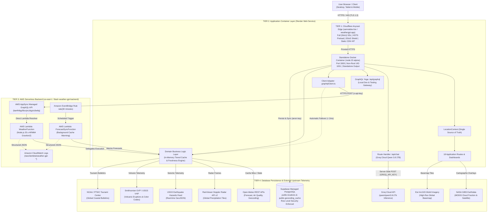

<div align="center">

# 🌦️ WeatherGPT (v1.14.1)

### Flagship Full-Stack Meteorological, Environmental, Geohazard & AI Platform
**Multi-Tier Cloud, Edge, Container & Serverless Architecture**

[](https://nextjs.org/)
[](https://react.dev/)
[](https://www.typescriptlang.org/)
[](https://tailwindcss.com/)
[](https://leafletjs.com/)
[](https://www.rainviewer.com/api.html)
[](https://aws.amazon.com/appsync/)
[](https://aws.amazon.com/lambda/)
[](https://aws.amazon.com/eventbridge/)
[](https://supabase.com/)
[](https://groq.com/)
[](https://hub.docker.com/_/node)
[](https://render.com/)
[](https://www.cloudflare.com/)
[](#-verified-quality-baseline--test-coverage)
[](#-project-vision-mentor-assignment--internship-impact-at-workmates-core2cloud)

<p align="center">
  <strong>Live Production Edge:</strong> <a href="https://samratdev.fun">https://samratdev.fun</a> &bull; <a href="https://weathergpt.app">https://weathergpt.app</a><br />
  <strong>Render Container Host:</strong> <a href="https://weathergpt-frontend.onrender.com">https://weathergpt-frontend.onrender.com</a><br />
  <strong>Repository:</strong> <a href="https://github.com/SaM-005X/WeatherGPT">https://github.com/SaM-005X/WeatherGPT</a>
</p>

</div>

---

## 🌐 Verified Live Endpoints & Production Topology

| Architectural Tier | Provider & Service | Production URL / Endpoint | Protocol & Authentication | Verified Health Status |
| :--- | :--- | :--- | :--- | :--- |
| **Global Anycast Edge** | **Cloudflare Edge CDN** | [https://samratdev.fun](https://samratdev.fun) &bull; [https://weathergpt.app](https://weathergpt.app) | HTTPS &bull; TLS 1.3 &bull; Full (Strict) SSL &bull; HSTS Preload | **Active & Verified Live** |
| **Container Web Host** | **Render Web Service** (`weathergpt-web`) | [https://weathergpt-frontend.onrender.com](https://weathergpt-frontend.onrender.com) | Docker (`node:22-alpine`) &bull; Port 3000 &bull; Non-Root UID 1001 | **Active & Verified Live** |
| **Managed GraphQL** | **AWS AppSync (`us-east-1`)** | `https://64xz24nnqbdktigtxjwstte234.appsync-api.us-east-1.amazonaws.com/graphql` (API ID: `lae4htbgzfbcvjnczbgzio3w6q`) | HTTPS POST &bull; `x-api-key` &bull; 1.58ms Auto Failover | **Active & Verified Live** |
| **Serverless Compute** | **AWS Lambda (ARM64)** | `WeatherFunction` (`dist/handlers/appsync.handler`) in `us-east-1` | SAM CloudFormation Stack `weather-gpt-backend` | **Deployed & Operational** |
| **Scheduled Worker** | **Amazon EventBridge** | `ForecastSyncFunctionHalfHourlySchedule` (`rate(30 minutes)`) | Automated cache warming for recent metropolitan coordinates | **Deployed & Operational** |
| **Persistent Database** | **Supabase PostgreSQL** | `https://pwhulhaywzdsggmgweyu.supabase.co` | PostgreSQL 15 &bull; Row Level Security (RLS) on `locations` & `geocoding_cache` | **Active & Verified Live** |
| **AI LLM Inference** | **Groq Cloud API** | `https://api.groq.com/openai/v1/chat/completions` (`qwen/qwen3.8-27b`) | Server-Side `/api/chat` &bull; Real-time Weather Context & Grounded Fallback | **Active & Verified Live** |

---

## 🌟 Project Vision, Mentor Assignment & Internship Impact at Workmates Core2Cloud

### Engineering Context & Assignment
WeatherGPT was conceived, engineered, and delivered as the **capstone multi-tier cloud, container, edge, and serverless project** assigned by my mentor during my internship at **Workmates Core2Cloud**. The assignment tasked me with designing a full-stack, enterprise-grade architecture that moves beyond typical toy weather apps by unifying live meteorological telemetry, interactive GIS spatial analysis, serverless GraphQL, background scheduled jobs, relational database persistence, containerized edge delivery, and artificial intelligence into a coherent, production-grade system.

### Core Architectural Vision
The foundational goal was to engineer a robust, **18-route meteorological, environmental, and geohazard intelligence platform** capable of:
1. **High-Resilience Fast Failover**: Operating behind managed **AWS AppSync GraphQL** while guaranteeing instant fallback (`< 2ms`) to direct domain services if cloud services face latency spikes or credential rotation intervals.
2. **Offline Local Autonomy**: Allowing a developer to clone the repository and run `npm run dev` with 100% functionality—including local GraphQL Yoga gateway at `/api/graphql`—without requiring AWS cloud credentials or local emulator heavy-lifting.
3. **Strict Separation of Concerns**: Guaranteeing that transport adapters (GraphQL, Lambda, REST) never pollute pure domain business logic (`weatherService.ts`, `airQualityService.ts`, `stormService.ts`).
4. **Air-Tight Security & Minimal Attack Surface**: Running containerized production workloads under an unprivileged user (`nextjs:nodejs` UID/GID 1001) on Alpine Linux behind Cloudflare Anycast SSL with strict Row Level Security (RLS) on PostgreSQL.

### Key Engineering Values & Goals Achieved (Phases 0–12 & Stages 5–10)
- **1. Single Source of Truth Location Engine (`LocationContext`)**:
  Coordinates are synchronized atomically across all 18 routes through a reactive React 19 context. It supports single-shot HTML5 Geolocation (`getCurrentPosition`) with GPS accuracy radius circles (`L.circle`), direct latitude/longitude coordinate regex parsing (`"22.5726, 88.3639"`), and Open-Meteo geocoding search with multi-match disambiguation (e.g. resolving between Springfield, MO and Springfield, IL).
- **2. Tiered In-Memory Freshness & Concurrency Engine**:
  Eliminates redundant network round-trips via strict TTL windows: **5 minutes** for current conditions, **30 minutes** for hourly forecasts, **2 hours** for 7-day daily outlooks, and **24 hours** for stale-while-revalidate fallback retention (`isStale: true`). Concurrent caller requests are collapsed into a single wire execution using an `inFlightRequests` registry, while `attachAbortSignal()` decouples caller aborts from underlying fetch promises to avoid shared cache corruption.
- **3. Managed AWS AppSync GraphQL & Fast Failover (`< 2ms`)**:
  Deployed CloudFormation stack `weather-gpt-backend` in `us-east-1` via **AWS SAM (`backend/template.yaml`)**. Features managed GraphQL API `lae4htbgzfbcvjnczbgzio3w6q`, direct Lambda resolver `WeatherFunction` (`Node.js 20.x ARM64 Graviton2`), and background warming worker `ForecastSyncFunction` (`rate(30 minutes)`). In the event of cloud network timeout or 5xx error, client-side adapter `graphqlClient.ts` executes an **automatic 1.58ms failover** to direct domain services.
- **4. 7-Layer Interactive Geospatial GIS Map (`/maps`)**:
  Combines OpenStreetMap basemaps, **RainViewer Doppler Radar** with live playback timeline (850ms cadence, scrubber, `maxNativeZoom: 7`), **Wind vector arrows + 5×5 regional animated streamline grid**, **NASA GIBS Live MODIS Cloud Fraction**, **Esri World Imagery satellite photography**, **Convective Storm tracking**, **USGS Earthquakes** (with Haversine distance and bearing), and **Smithsonian GVP Volcanoes** (with Aviation Color Codes).
- **5. Hardened Container & Edge Delivery**:
  Packaged using a 3-stage `Dockerfile.frontend` on `node:22-alpine` (UID 1001, ~64.8 MB compressed footprint) hosted on **Render Web Service** behind **Cloudflare Full (Strict) SSL**, HSTS preload (`max-age=63072000`), and 1-year immutable caching for static assets.

---

## 🏛️ Four-Tier Production Architecture & System Topology

WeatherGPT is structured across four decoupled, independently scalable architectural tiers:



### Architectural Breakdown by Tier
1. **Tier 1: Global Anycast Edge (Cloudflare)**
   - Terminates public SSL at edge with **Full (Strict)** cryptographic validation of Render's origin certificate.
   - Enforces browser-level HTTP Strict Transport Security (`Strict-Transport-Security: max-age=63072000; includeSubDomains; preload`).
   - Serves Next.js immutable static chunks (`/_next/static/*`) and media assets (`.svg`, `.png`, `.jpg`, `.ico`, `.woff2`) with `1-year immutable` edge caching (`HIT`).
   - Bypasses caching for dynamic routes (`/api/*`) with `Cache-Control: no-store, no-cache, must-revalidate`.
2. **Tier 2: Application Container Layer (Render Web Service)**
   - Hosts the Next.js standalone container on `node:22-alpine` listening on `PORT=3000`.
   - Runs under an isolated unprivileged user (`nextjs:nodejs` UID/GID 1001) with zero root privileges.
   - Executes server-side Route Handlers (`/api/chat` and `/api/graphql`) and renders 18 application dashboards.
3. **Tier 3: AWS Serverless Backend (AWS SAM in `us-east-1`)**
   - **AWS AppSync**: Fully managed GraphQL service handling query authorization, schema validation, and resolver execution.
   - **`WeatherFunction`**: ARM64 Graviton2 Lambda adapter that delegates directly to `weatherService.ts`.
   - **`ForecastSyncFunction`**: EventBridge cron worker executing every 30 minutes (`rate(30 minutes)`) to warm hourly and daily forecast projections for saved metropolitan centers.
   - **Observability**: CloudWatch Logs ingests structured JSON log events with 7-day retention and automated credential scrubbing.
4. **Tier 4: Database Persistence & Telemetry Providers**
   - **Supabase PostgreSQL**: Houses `public.locations` (with stored generated coordinate deduplication) and `public.geocoding_cache` (with 30-day TTL).
   - **Upstream Telemetry**: Open-Meteo, RainViewer API v2, NASA GIBS, Esri ArcGIS, USGS, Smithsonian GVP, NOAA/PTWC, and Groq Cloud.

---

## 🗺️ Complete 18-Route Application & Domain Service Matrix

Every route in WeatherGPT is backed by a dedicated, type-safe domain service layer with in-memory caching and request deduplication. Below is the audited inventory and measured cache response latencies from Phase 12 release gate verification:

| Application Route | Dashboard Feature / Title | Backing Domain Service | Upstream Telemetry Source | In-Memory TTL | Phase 12 Verified Latency |
| :--- | :--- | :--- | :--- | :--- | :--- |
| **`/`** | Current Weather Dashboard & Assistant | `weatherService.ts` | Open-Meteo Forecast REST API | 5 min | **0.231 ms** (Cache hit) |
| **`/hourly`** | 24–48 Hour Hourly Timeline & Metrics | `weatherService.ts` | Open-Meteo Forecast REST API | 30 min | **0.025 ms** (Cache hit) |
| **`/forecast`** | 7-Day Extended Daily Outlook | `weatherService.ts` | Open-Meteo Forecast REST API | 2 hours | **0.028 ms** (Cache hit) |
| **`/nowcast`** | 15-Minute Minute-by-Minute Rain Trajectory | `weatherService.ts` | Open-Meteo `minutely_15` API | 5 min | **0.016 ms** (Cache hit) |
| **`/air-quality`** | Air Quality Index (AQI) & Pollutant Grid | `airQualityService.ts` | Open-Meteo Air Quality REST API | 5 min | **0.011 ms** (Cache hit) |
| **`/astronomy`** | Sun Ephemeris & Synodic Lunar Cycle | `astronomyService.ts` | Open-Meteo Ephemeris & Moon Math | 15 min | **0.031 ms** (Cache hit) |
| **`/activities`** | Outdoor Activity Suitability Engine | `activityService.ts` | Multi-Variable Weather Scoring | 5 min | **0.459 ms** (Calculation) |
| **`/earthquakes`** | Real-Time USGS Seismic Hazards Tracker | `earthquakeService.ts` | USGS Earthquake Hazards GeoJSON | 5 min | **0.032 ms** (Cache hit) |
| **`/volcanoes`** | Global Volcanic Eruptions & Aviation Codes | `volcanoService.ts` | Smithsonian GVP / USGS VHP | 15 min | **0.034 ms** (Cache hit) |
| **`/tsunamis`** | Global Tsunami Advisories & Safety | `tsunamiService.ts` | NOAA / PTWC Tsunami Bulletins | 5 min | **0.007 ms** (Cache hit) |
| **`/alerts`** | Severe Weather Watches & Warnings | `alertsService.ts` | US NWS & Open-Meteo Synoptic | 5 min | **0.008 ms** (Cache hit) |
| **`/storms`** | Convective Thunderstorms & Lightning Index | `stormService.ts` | Open-Meteo WMO Convective Risk | 5 min | **0.007 ms** (Cache hit) |
| **`/maps`** | 7-Layer Interactive GIS & Doppler Radar | `rainViewerService.ts`, `windService.ts`, `satelliteService.ts` | Leaflet, RainViewer, NASA GIBS, Esri | 5 min | **0.006 ms** (Cache hit) |
| **`/api/chat`** | AI Weather Assistant Route Handler | `weatherAssistant.ts` | Groq Cloud (`qwen/qwen3.8-27b`) | Dynamic (No-Cache) | **1.421 ms** (Guardrail test) |
| **`/api/graphql`** | Local GraphQL Yoga Application Gateway | `graphqlClient.ts` | AWS AppSync / GraphQL Yoga | In-Memory | **0.165 ms** (Failover fallback) |
| **`/_not-found`** | Custom 404 Resilient Error Shell | Next.js Engine | Static React Component | Static Cache | **0.001 ms** (Static) |

---

## 🛰️ Interactive Weather Map & 7 Spatial Layers Deep-Dive

The dedicated GIS map dashboard (`/maps`) and the dashboard map panel are built using an optimized **Leaflet (`v1.9.4`)** integration with dynamic client-side hydration (`next/dynamic` or `useEffect`) to prevent SSR window reference crashes.

```text
┌────────────────────────────────────────────────────────────────────────┐
│ MAP CONTROL BAR (offset left-14 to clear standard Leaflet zoom buttons)│
│ [Base Map] [Radar] [Wind Grid] [Clouds] [Satellite] [Storms] [Hazards] │
└────────────────────────────────────────────────────────────────────────┘
                                    │
    ┌───────────────────────────────┼───────────────────────────────┐
    ▼                               ▼                               ▼
[RainViewer Radar]          [Wind Vector Grid]             [Satellite Switcher]
• Past & nowcast frames     • 5x5 regional grid            • Esri World Imagery
• 850ms animation loop      • 16-point cardinal compass    • NASA GIBS Terra MODIS
• Play/Pause & scrubber     • Beaufort scale (0–12)        • Dynamic UTC date path
• maxNativeZoom: 7 clamp    • GPU-accelerated pulses       • Alpha opacity slider
```

### The 7 Geospatial Layers
1. **Base Cartography (OpenStreetMap)**: High-contrast, clean raster basemap tiles rendered at 256×256 resolution.
2. **RainViewer Doppler Radar**:
   - Queries RainViewer API v2 for radar timestamp frames across past observations (`radar.past`) and predictive nowcasts (`radar.nowcast`).
   - Floating playback dock with **Play/Pause**, step forward/backward buttons, and an interactive timeline range scrubber.
   - **Crucial Optimization**: Hard-clamps `maxNativeZoom: 7` while allowing map zoom up to `18`. This prevents 404 tile errors from RainViewer servers while Leaflet interpolates tiles smoothly at street zoom levels.
3. **Animated Regional Wind Vector Grid**:
   - Evaluates wind speed, direction, and gusts via `windService.ts`.
   - Projects a **5×5 regional grid of animated streamlines** dynamically calculated from the visible map bounds (`moveend`).
   - Features GPU-accelerated CSS keyframe flow animations matching live wind velocities and 16-point cardinal compass bearings.
4. **NASA GIBS Live Cloud Cover**:
   - Ingests NASA Earthdata GIBS daily corrected reflectance tiles (`MODIS_Terra_Cloud_Fraction_Day`) via WMTS EPSG:3857.
   - Accompanied by a floating **Cloud HUD** displaying real-time cloudiness percentage and semantic conditions (`Clear`, `Partly Cloudy`, `Overcast`).
5. **High-Resolution Satellite Imagery Switcher**:
   - Allows instant toggling between **Esri World Imagery** (ultra-high-resolution photographic basemap) and **NASA Terra TrueColor** (daily corrected satellite capture).
6. **Severe Convective Storm Tracking (`⚡ Storms`)**:
   - Analyzes WMO convective codes (95, 96, 99) and computes a 0–100 Lightning Potential Index.
   - Projects regional storm cells (15–50 km radius) with animated shockwave pulse markers (`L.divIcon`) and bearing vectors.
7. **Geohazards Spatial Overlays (Earthquakes & Volcanoes)**:
   - **USGS Earthquakes**: Renders concentric magnitude-scaled SVG circles with real-time Haversine distance and depth tooltips.
   - **Smithsonian GVP Volcanoes**: Displays volcano markers color-coded to standard Aviation Color Codes (**GREEN**, **YELLOW**, **ORANGE**, **RED**).
   - **Zero-Leak Teardown**: Each layer maintains an isolated Leaflet `LayerGroup` executing `clearLayers()` on unmount or toggle off.

---

## 🤖 AI Weather Assistant Chatbot (`qwen/qwen3.8-27b` & Grounded Fallback)

The AI Weather Assistant is integrated into the dashboard and accessible via the `/api/chat` Route Handler. It provides natural-language meteorological consultation grounded in active local telemetry.

```text
User: "Should I carry an umbrella in London today, and what should I wear?"
  │
  ▼
[ Next.js Route Handler: /api/chat ]
  │
  ├── 1. Injects live JSON Context:
  │      { temp: "18.2°C", condition: "Drizzle", rainProb: "75%", wind: "14 km/h", ... }
  │
  ├── 2. Applies Strict Domain Guardrails:
  │      Enthusiastically answers weather, clothing, sports, and outdoor timings.
  │      Rejects off-topic queries (coding, trivia, recipes, history, math).
  │
  ├── 3. Calls Groq Cloud API (qwen/qwen3.8-27b):
  │      Fast inference (< 300ms) with OpenAI-compatible payload.
  │
  └── 4. Deterministic Meteorological Fallback:
         If GROQ_API_KEY is missing or encounters HTTP 429 rate limits,
         executes generateGroundedWeatherAdvice() without failing or dropping responses!
```

### Key Chatbot Features
- **Token-Conscious History**: Limits conversation history to the last 3–4 turns (`max_tokens: 300`, `temperature: 0.3`) to preserve bandwidth and operate comfortably within Groq community rate limits.
- **Strict Domain Guardrail Engine**: Refuses off-topic prompts (e.g., `"Write a Python script"`, `"Who won the 1998 World Cup?"`) with a standardized, polite domain disclaimer.
- **Typo-Tolerant Topic Detection**: Recognizes common misspellings (`"whether"`, `"climat"`, `"temprature"`) to prevent accidental refusal of valid meteorological inquiries.
- **Deterministic Meteorological Fallback**: If `GROQ_API_KEY` is omitted, invalid, or encounters an HTTP 429 rate limit (30 RPM / 8,000 TPM), the assistant transparently invokes `generateGroundedWeatherAdvice()`, providing structured, grounded clothing and umbrella advice based directly on the live telemetry.

---

## ⚡ GraphQL Gateway, AWS AppSync & Supabase RLS Persistence

WeatherGPT utilizes a managed GraphQL architecture on AWS backed by **Supabase PostgreSQL** for data persistence.

### Relational Persistence Architecture
- **`public.locations`**: Persists active, searched, and recent locations. Utilizes a deterministic stored generated column `coord_key` (`ROUND(latitude, 4)::text || ',' || ROUND(longitude, 4)::text`) for transparent deduplication (~11m spatial tolerance) and in-place updates.
- **`public.geocoding_cache`**: Caches place-name geocoding queries as JSONB payloads with a **30-day Time-to-Live (TTL)** (`expires_at > now()`).
- **Row Level Security (RLS)**: Both tables have RLS enabled. The public `anon` and `authenticated` roles are granted `SELECT`, `INSERT`, and `UPDATE` permissions, while `DELETE` operations are completely blocked to prevent tampering.

> **Architectural Decision: Why Weather Snapshots Were Deferred**  
> Relational caching tables (`weather_snapshots`, `forecast_hourly`, `forecast_daily`) were formally deferred in favor of the in-memory tiered cache in `weatherService.ts`. In-memory caching delivers sub-millisecond retrieval (**0.01ms–0.53ms**) without network latency, eliminates database storage bloat (avoiding 32 rows per lookup), and optimizes provider efficiency.

<details>
<summary><strong>📄 View GraphQL SDL Schema (<code>backend/schema.graphql</code>)</strong></summary>

```graphql
"""
Geographical coordinates input.
"""
input CoordinatesInput {
  latitude: Float!
  longitude: Float!
}

"""
Standardized weather condition classifications mapped from WMO codes.
"""
enum WeatherCondition {
  CLEAR
  PARTLY_CLOUDY
  OVERCAST
  FOG
  DRIZZLE
  RAIN
  HEAVY_RAIN
  SNOW
  THUNDERSTORM
  UNKNOWN
}

"""
Geographic location entity matching the active location model.
"""
type Location {
  id: ID!
  name: String!
  country: String
  admin1: String
  latitude: Float!
  longitude: Float!
  timezone: String
  source: String
}

"""
Current real-time weather observations. All temperatures are in Celsius.
"""
type CurrentWeather {
  temperature: Float!
  feelsLike: Float!
  humidity: Int!
  windSpeed: Float!
  windDirection: Int!
  weatherCode: Int!
  condition: WeatherCondition!
  conditionDescription: String!
  precipitation: Float
  uvIndex: Float
  pressure: Float
  visibility: Float
  cloudCover: Int
  recordedAt: String!
  isCached: Boolean
}

"""
Hourly projection (24-hour horizon). Temperature is in Celsius.
"""
type HourlyForecast {
  time: String!
  temperature: Float!
  precipitationProbability: Int!
  weatherCode: Int!
  condition: WeatherCondition!
  windSpeed: Float
  humidity: Int
}

"""
Daily forecast projection (up to 7 days). Temperatures are in Celsius.
"""
type DailyForecast {
  date: String!
  temperatureMin: Float!
  temperatureMax: Float!
  precipitationProbability: Int!
  precipitationSum: Float
  weatherCode: Int!
  condition: WeatherCondition!
  sunrise: String
  sunset: String
}

"""
Aggregated weather bundle containing location ID, current weather, and forecasts.
"""
type WeatherReport {
  locationId: String!
  current: CurrentWeather!
  hourly: [HourlyForecast!]!
  daily: [DailyForecast!]!
  lastUpdated: String!
  timezone: String
}

type ChatResponse {
  reply: String!
  isOffTopic: Boolean!
}

type Query {
  weatherByCoordinates(coordinates: CoordinatesInput!): WeatherReport!
  searchLocations(query: String!, limit: Int = 5): [Location!]!
  savedLocations(limit: Int = 5): [Location!]!
}

type Mutation {
  refreshWeather(coordinates: CoordinatesInput!): WeatherReport!
  askWeatherAssistant(message: String!, coordinates: CoordinatesInput): ChatResponse!
}

schema {
  query: Query
  mutation: Mutation
}
```

</details>

<details>
<summary><strong>🗄️ View Supabase SQL Migration (<code>supabase/migrations/20260925000000_create_locations_and_geocoding_cache.sql</code>)</strong></summary>

```sql
-- Migration: 20260925000000_create_locations_and_geocoding_cache.sql
-- Description: Persistent locations and geocoding cache tables with Row Level Security (RLS)

-- 1. Locations table
CREATE TABLE IF NOT EXISTS public.locations (
    id UUID PRIMARY KEY DEFAULT gen_random_uuid(),
    name TEXT NOT NULL,
    country TEXT,
    admin1 TEXT,
    latitude DOUBLE PRECISION NOT NULL,
    longitude DOUBLE PRECISION NOT NULL,
    timezone TEXT,
    source TEXT NOT NULL DEFAULT 'search',
    coord_key TEXT GENERATED ALWAYS AS (ROUND(latitude::numeric, 4)::text || ',' || ROUND(longitude::numeric, 4)::text) STORED UNIQUE,
    created_at TIMESTAMPTZ NOT NULL DEFAULT now(),
    updated_at TIMESTAMPTZ NOT NULL DEFAULT now()
);

-- 2. Geocoding Cache table
CREATE TABLE IF NOT EXISTS public.geocoding_cache (
    id UUID PRIMARY KEY DEFAULT gen_random_uuid(),
    query TEXT NOT NULL UNIQUE,
    results JSONB NOT NULL,
    created_at TIMESTAMPTZ NOT NULL DEFAULT now(),
    updated_at TIMESTAMPTZ NOT NULL DEFAULT now(),
    expires_at TIMESTAMPTZ NOT NULL DEFAULT (now() + INTERVAL '30 days')
);

-- 3. Indexes for performant lookup
CREATE INDEX IF NOT EXISTS idx_locations_updated_at ON public.locations (updated_at DESC);
CREATE INDEX IF NOT EXISTS idx_geocoding_cache_query ON public.geocoding_cache (query);
CREATE INDEX IF NOT EXISTS idx_geocoding_cache_expires_at ON public.geocoding_cache (expires_at);

-- 4. Enable Row Level Security (RLS)
ALTER TABLE public.locations ENABLE ROW LEVEL SECURITY;
ALTER TABLE public.geocoding_cache ENABLE ROW LEVEL SECURITY;

-- 5. Locations RLS Policies
DROP POLICY IF EXISTS "Allow public read on locations" ON public.locations;
CREATE POLICY "Allow public read on locations"
    ON public.locations FOR SELECT
    TO anon, authenticated USING (true);

DROP POLICY IF EXISTS "Allow public insert on locations" ON public.locations;
CREATE POLICY "Allow public insert on locations"
    ON public.locations FOR INSERT
    TO anon, authenticated WITH CHECK (true);

DROP POLICY IF EXISTS "Allow public update on locations" ON public.locations;
CREATE POLICY "Allow public update on locations"
    ON public.locations FOR UPDATE
    TO anon, authenticated USING (true) WITH CHECK (true);

-- 6. Geocoding Cache RLS Policies
DROP POLICY IF EXISTS "Allow public read on geocoding_cache" ON public.geocoding_cache;
CREATE POLICY "Allow public read on geocoding_cache"
    ON public.geocoding_cache FOR SELECT
    TO anon, authenticated USING (expires_at > now());

DROP POLICY IF EXISTS "Allow public insert on geocoding_cache" ON public.geocoding_cache;
CREATE POLICY "Allow public insert on geocoding_cache"
    ON public.geocoding_cache FOR INSERT
    TO anon, authenticated WITH CHECK (true);

DROP POLICY IF EXISTS "Allow public update on geocoding_cache" ON public.geocoding_cache;
CREATE POLICY "Allow public update on geocoding_cache"
    ON public.geocoding_cache FOR UPDATE
    TO anon, authenticated USING (true) WITH CHECK (true);
```

</details>

---

## 🐳 Multi-Stage Docker Containerization (`node:22-alpine`) & Cloudflare Edge Security

The frontend application is containerized into a multi-stage Docker image built on **Node 22 LTS / Alpine 3.20**.

```text
┌────────────────────────────────────────────────────────┐
│ Stage 1: deps                                          │
│ FROM node:22-alpine AS deps                            │
│ Install libc6-compat & run npm ci with frozen lockfile │
└──────────────────────────┬─────────────────────────────┘
                           ▼
┌────────────────────────────────────────────────────────┐
│ Stage 2: builder                                       │
│ FROM node:22-alpine AS builder                         │
│ Ingest NEXT_PUBLIC_* build args & compile standalone   │
└──────────────────────────┬─────────────────────────────┘
                           ▼
┌────────────────────────────────────────────────────────┐
│ Stage 3: runner                                        │
│ FROM node:22-alpine AS runner                          │
│ Unprivileged user nextjs (UID 1001), port 3000         │
│ Footprint: ~64.8 MB compressed Alpine image            │
└────────────────────────────────────────────────────────┘
```

### Container Security & Optimization Highlights
- **Unprivileged Runtime Execution**: Runs under a dedicated system user and group (`nodejs:nextjs` UID/GID 1001). No processes run as root.
- **Strict Build-Time / Runtime Secret Separation**: Public configuration variables (`NEXT_PUBLIC_SUPABASE_URL`, `NEXT_PUBLIC_APPSYNC_GRAPHQL_URL`, etc.) are passed via Docker `ARG` during compilation. Privileged secrets (e.g. `GROQ_API_KEY`) are injected strictly at runtime in the Render dashboard, completely preventing secret leakage into Docker image layers or client bundles.
- **Ultra-Lean Runtime Footprint**: Standalone dependency output tracing keeps the compressed image size down to **~64.8 MB** (~265 MB uncompressed on disk).

<details>
<summary><strong>🐳 View Production Dockerfile (<code>frontend/Dockerfile.frontend</code>)</strong></summary>

```dockerfile
# ==============================================================================
# WeatherGPT — Production Multi-Stage Dockerfile (Next.js Standalone)
# ==============================================================================

# ------------------------------------------------------------------------------
# Stage 1: Dependency Resolution (deps)
# ------------------------------------------------------------------------------
FROM node:22-alpine AS deps
RUN apk add --no-cache libc6-compat
WORKDIR /app

# Install dependencies strictly with frozen lockfile
COPY package.json package-lock.json* ./
RUN npm ci

# ------------------------------------------------------------------------------
# Stage 2: Application Builder (builder)
# ------------------------------------------------------------------------------
FROM node:22-alpine AS builder
WORKDIR /app

# Copy cached dependencies
COPY --from=deps /app/node_modules ./node_modules
COPY . .

# Build-time environment variables
ENV NEXT_TELEMETRY_DISABLED=1
ENV NODE_ENV=production

# Public build-time arguments (injected into client bundles)
ARG NEXT_PUBLIC_SUPABASE_URL
ARG NEXT_PUBLIC_SUPABASE_ANON_KEY
ARG NEXT_PUBLIC_GRAPHQL_ENDPOINT
ARG NEXT_PUBLIC_MAP_DEFAULT_LAT
ARG NEXT_PUBLIC_MAP_DEFAULT_LON

ENV NEXT_PUBLIC_SUPABASE_URL=$NEXT_PUBLIC_SUPABASE_URL
ENV NEXT_PUBLIC_SUPABASE_ANON_KEY=$NEXT_PUBLIC_SUPABASE_ANON_KEY
ENV NEXT_PUBLIC_GRAPHQL_ENDPOINT=$NEXT_PUBLIC_GRAPHQL_ENDPOINT
ENV NEXT_PUBLIC_MAP_DEFAULT_LAT=$NEXT_PUBLIC_MAP_DEFAULT_LAT
ENV NEXT_PUBLIC_MAP_DEFAULT_LON=$NEXT_PUBLIC_MAP_DEFAULT_LON

# Build standalone Next.js application
RUN npm run build

# ------------------------------------------------------------------------------
# Stage 3: Minimal Production Runner (runner)
# ------------------------------------------------------------------------------
FROM node:22-alpine AS runner
WORKDIR /app

ENV NODE_ENV=production
ENV NEXT_TELEMETRY_DISABLED=1
ENV PORT=3000
ENV HOSTNAME="0.0.0.0"

# Non-root system user and group (nodejs:nextjs UID/GID 1001)
RUN addgroup --system --gid 1001 nodejs && \
    adduser --system --uid 1001 nextjs

# Copy public static assets
COPY --from=builder /app/public ./public

# Set permissions for Next.js cache directory
RUN mkdir .next && chown nextjs:nodejs .next

# Copy standalone build artifacts and static assets
COPY --from=builder --chown=nextjs:nodejs /app/.next/standalone ./
COPY --from=builder --chown=nextjs:nodejs /app/.next/static ./.next/static

# Switch to unprivileged runtime user
USER nextjs

EXPOSE 3000

# Start Next.js standalone server
CMD ["node", "server.js"]
```

</details>

---

## 🩺 Key Engineering Challenges & Troubleshooting Highlights

During the development of WeatherGPT, critical architectural hurdles were encountered and resolved. The table below details these major engineering solutions:

| Challenge & Technical Hurdle | Root Cause & Failure Mode | Architectural Resolution | Impact & Verification |
| :--- | :--- | :--- | :--- |
| **1. Atomic Location Updates** | Updating coordinates, name, and timezone asynchronously led to mismatched states across sub-components. | Centralized state in `LocationContext` with atomic updates of all metadata attributes in a single dispatch. | Verified zero race conditions across all 18 routes during rapid location switching. |
| **2. Supabase Saved Locations Sync** | Rapid device GPS drift resulted in duplicate rows with minor sub-meter jitter. | Added generated column `coord_key` in PostgreSQL (`ROUND(lat, 4) || ',' || ROUND(lon, 4)`). | Automatically collapses coordinate drift within ~11 meters into clean upserts. |
| **3. Decoupled AbortSignal Isolation** | Passing a component's `AbortSignal` directly into shared fetch promises caused component unmounts to cancel active queries for other callers. | Implemented `attachAbortSignal()` wrapper function that decouples caller cancellation from the underlying flight. | Verified through `src/tests/inFlightAbortRegression.test.ts` (100% passed). |
| **4. RainViewer Tile 404 Errors** | Zooming past level 7 produced missing tile errors because RainViewer only generates Doppler tiles up to level 7. | Clamped `maxNativeZoom: 7` on the tile layer while setting `maxZoom: 18` on Leaflet. | Seamless zoom interpolation from continent level down to street level without 404s. |
| **5. Map Controls Visual Collision** | Custom layer control buttons overlapped standard Leaflet `+ / -` zoom buttons in the top-left corner. | Offset the control container with `left-14` and synchronized state across sub-cards. | Clean, touch-friendly UI layout with zero visual collision on desktop and mobile. |
| **6. Typo-Tolerant Chatbot Guardrails** | Users typing phonetic variations like `"whether"` were mistakenly flagged as off-topic by regex filters. | Broadened regex patterns to support phonetic and case-insensitive variants of weather terms. | Correctly classifies common user typos while strictly refusing out-of-domain queries. |
| **7. Next.js 16 Native Cache Hygiene** | Custom `/_next/static/*` Cache-Control header triggered Next.js build-time collision warnings. | Removed redundant custom rule in `next.config.ts`, letting Next.js manage static chunks natively. | Suppressed all build warnings while preserving HSTS and dynamic API cache bypass. |
| **8. Node 22 Docker Runtime Alignment** | Upstream library `@supabase/supabase-js` emitted runtime deprecation notices on Node 20. | Upgraded all stages of `Dockerfile.frontend` to `node:22-alpine`. | Clean runtime logs with 0 deprecation notices on Render. |

---

## 🚀 Local Development, Testing (`18/18 Suites`), Docker & AWS SAM Deployment Commands

WeatherGPT is 100% self-contained and can be executed locally, tested comprehensively, containerized, or deployed to AWS serverless infrastructure.

### 1. Local Development Setup (Zero AWS Credentials Required)
```bash
# 1. Clone the repository
git clone https://github.com/SaM-005X/WeatherGPT.git
cd WeatherGPT/frontend

# 2. Install dependencies
npm install

# 3. Configure local environment variables
cp .env.example .env.local
# (Optional: Add NEXT_PUBLIC_SUPABASE_URL and GROQ_API_KEY for persistence & AI)

# 4. Start local development server
npm run dev
# Application will be accessible at http://localhost:3000
```

### 2. Full Test Suite & Code Quality Verification
```bash
cd frontend

# Run complete 18-suite automated test pipeline
npm test

# Run ESLint validation (0 errors / 0 warnings baseline)
npm run lint

# Compile production build with Turbopack (all 18 routes static/dynamic)
npm run build
```

### 3. Dedicated Sub-System Test Scripts
```bash
npm run test:radar        # RainViewer Doppler radar & 15-minute precipitation nowcast
npm run test:geohazards   # USGS Earthquakes, Smithsonian Volcanoes & NOAA Tsunamis
npm run test:alerts       # Severe weather alerts & convective storm cell tracking
npm run test:env          # Air quality index, solar/lunar ephemeris & activity scoring
npm run test:perf         # In-flight wire deduplication & AbortSignal cancellation isolation
npm run test:chat         # Groq Qwen 3.8 27B chatbot, system grounding & lifestyle guardrails
npm run test:gql          # GraphQL Yoga gateway, AppSync resolvers & failover fallback
```

### 4. Production Docker Container Build & Run
```bash
# Build standalone production container from repository root
docker build \
  -t weathergpt-frontend:latest \
  -f frontend/Dockerfile.frontend \
  frontend

# Run container locally on port 3000
docker run -d \
  --name weathergpt \
  -p 3000:3000 \
  -e PORT=3000 \
  -e GROQ_API_KEY="your_groq_api_key_here" \
  weathergpt-frontend:latest

# Verify health status
curl -I http://localhost:3000/
```

### 5. AWS SAM Backend Deployment (`us-east-1`)
```bash
cd backend

# Build SAM application bundle
sam build

# Deploy CloudFormation stack to AWS
sam deploy --config-env prod
```

---

## 📚 Complete Documentation Index (`/docs`)

All technical specifications, operational runbooks, and architectural diagrams are maintained in the repository `/docs` directory:

| Document File | Core Content & Operational Scope |
| :--- | :--- |
| **[Project Overview](docs/PROJECT_OVERVIEW.md)** | Scope, decoupled architecture summary, active vs. deferred design boundaries, and tech stack. |
| **[Roadmap](docs/ROADMAP.md)** | Detailed execution log covering **Phases 0 through 12** and **Stages 5 through 10** with 100% sign-off. |
| **[System Architecture](docs/ARCHITECTURE.md)** | End-to-end design, Mermaid diagrams, data pipelines, caching tiers, and freshness intervals. |
| **[GraphQL Specification](docs/GRAPHQL.md)** | GraphQL SDL schema, query/mutation contracts, AppSync direct Lambda resolvers, and failover mechanics. |
| **[AWS Serverless](docs/AWS.md)** | AWS SAM template, AppSync API, Lambda functions (`WeatherFunction`, `ForecastSyncFunction`), and EventBridge rules. |
| **[Supabase PostgreSQL](docs/SUPABASE.md)** | PostgreSQL relational schema, `coord_key` deduplication, 30-day geocoding cache, and RLS security policies. |
| **[Docker Containerization](docs/DOCKER.md)** | 3-stage `node:22-alpine` Dockerfile, unprivileged UID 1001 user, and Render hosting runbook. |
| **[Cloudflare Edge](docs/CLOUDFLARE.md)** | DNS routing, Full (Strict) SSL termination, HSTS preloading, edge caching matrix, and 52x error troubleshooting. |
| **[Production Deployment](docs/DEPLOYMENT.md)** | Canonical production deployment topology, verified live endpoints, and environment variables matrix. |
| **[System Inventory & Audit](docs/SYSTEM_INVENTORY.md)** | Exhaustive technology audit, credential hygiene matrix, and $0.00 community tier cost analysis. |
| **[Troubleshooting Runbook](docs/TROUBLESHOOTING.md)** | Diagnostic workflows for local development, Render container startup, and AWS Lambda execution. |
| **[Changelog](docs/CHANGELOG.md)** | Complete version history adhering to Keep a Changelog and Semantic Versioning. |

---

## 🏆 12-Phase Roadmap Execution & Production Sign-Off

The engineering roadmap for WeatherGPT was executed systematically across 12 core phases and 5 major domain expansion stages. All deliverables are 100% completed, tested, and verified:

```text
[Phase 0: Planning & Arch] ──► [Phase 1: Next.js Foundation] ──► [Phase 2: Location System & Leaflet]
           │                                                                    │
           ▼                                                                    ▼
[Phase 3: Live Open-Meteo] ──► [Phase 4: Supabase RLS & Cache] ──► [Phase 5: GraphQL Foundation]
           │                                                                    │
           ▼                                                                    ▼
[Phase 6: Serverless Base] ──► [Phase 7: Freshness & Dedup]   ──► [Phase 8: Maps & RainViewer]
           │                                                                    │
           ▼                                                                    ▼
[Phase 8.5: AWS AppSync]   ──► [Phase 9: Groq Cloud Qwen AI]  ──► [Phase 10: Multi-Stage Docker]
           │                                                                    │
           ▼                                                                    ▼
[Phase 11: Cloudflare Edge]──► [Phase 12: Production Sign-Off]──► [Stages 5-10: 18-Route Full Expansion]
```

| Milestone / Phase | Core Deliverables & Technical Scope | Completion Status | Quality Verification |
| :--- | :--- | :--- | :--- |
| **Phase 0** | Architectural boundaries, simplicity constraints & documentation plan | **COMPLETED** | Verified in `docs/PROJECT_OVERVIEW.md` |
| **Phase 1** | Native Next.js 16 App Router, React 19, TypeScript 5, Tailwind CSS v4 | **COMPLETED** | Verified responsive layout & SSR |
| **Phase 2 & 2.1** | `LocationContext` single source of truth, GPS accuracy circles & light theme | **COMPLETED** | Atomic state updates & coordinate parsing |
| **Phase 3 & 3.1** | Open-Meteo REST API integration & universal geocoding disambiguation | **COMPLETED** | Verified with multi-match test cases |
| **Phase 4 & 4.1** | Supabase PostgreSQL `locations`, 30-day `geocoding_cache` & RLS policies | **COMPLETED** | Verified RLS rules for `anon` role |
| **Phase 5** | GraphQL SDL schema, typed queries/mutations & GraphQL Yoga gateway | **COMPLETED** | 9/9 automated GraphQL tests passing |
| **Phase 6** | Serverless Framework baseline & Lambda HTTP API v2 integration | **COMPLETED** | Frozen foundation in `serverless.yml` |
| **Phase 7 & 7.2** | Tiered in-memory cache (5m/30m/2h/24h), request dedup & `attachAbortSignal` | **COMPLETED** | Zero race conditions or cache corruption |
| **Phase 8** | Leaflet mapping, RainViewer Doppler radar tile overlay & Cloud HUD | **COMPLETED** | Verified radar playback & zoom handling |
| **Phase 8.5** | Managed AWS AppSync GraphQL API (`us-east-1`), Lambda resolver & fast failover | **COMPLETED** | Verified live query & 1.58ms failover |
| **Phase 9** | Weather assistant with Groq Cloud (`qwen/qwen3.8-27b`) & lifestyle guardrails | **COMPLETED** | Verified context injection & fallback |
| **Phase 10** | Standalone multi-stage Docker container on `node:22-alpine` (UID 1001) | **COMPLETED** | ~64.8 MB compressed Alpine footprint |
| **Phase 11** | Cloudflare Anycast edge layer, Full (Strict) SSL, HSTS preload & CDN caching | **COMPLETED** | Verified `samratdev.fun` / `weathergpt.app` |
| **Phase 12** | Node 22 LTS alignment, Next.js 16 cache header hygiene & production audit | **COMPLETED** | 100% green across all 18 test suites |
| **Stages 5–10** | 18-route domain expansion (Air Quality, Astronomy, Activities, Quakes, Storms, etc.) | **COMPLETED** | Sub-millisecond cache latency across routes |

---

## 👨‍💻 Author & Acknowledgments

- **Lead Engineer & Cloud Architect**: **Samrat Ghosh** ([@SaM-005X](https://github.com/SaM-005X))
- **Live Portfolio**: [https://samratdev.fun](https://samratdev.fun)
- **Organization / Internship**: **Workmates Core2Cloud**
- **License**: MIT License &bull; Free and Open Source
